# 🧑‍🤝‍🧑 HCR – Wearable Elbow Assist Sleeve (Layer Jamming)

> Undergraduate research · Human-Centered Robotics Lab (Prof. Dongjun Shin), School of Mechanical Engineering, Chung-Ang University · Oct 2020 – Jun 2021 (incl. the 2021 Winter Mester program) · my own elbow-sleeve sub-project inside the lab's SLLJ sleeve research, mentored by a graduate student.

> Research on **human-centered robotic systems** integrating **wearable robotics, human–robot interaction, biosignal processing, and assistive technologies**.

| Wearing the Sleeve | Isometric Motion Test | Dynamic Motion Test |
|:------------------:|:---------------------:|:--------------------------:|
|  |  |  |

## 📖 Overview

The Human-Centered Robotics (HCR) project focused on developing robotic systems that improve human mobility and interaction through mechanical design, sensing, and control.

The research emphasized wearable robotic mechanisms, biosignal-driven interfaces, and rapid prototyping to bridge human intention with robotic assistance.

My part was an **elbow sleeve** built on **Slide-Linkage based Layer Jamming (SLLJ)**, a soft variable-stiffness mechanism from the lab ([W. H. Choi et al., 2019](https://doi.org/10.1109/LRA.2019.2908493)): thin TPU layers inside a sealed enclosure slide freely when vented and lock together under vacuum. The goal was a light, compact sleeve that helps the elbow in **isometric** holds (gravity compensation when holding a tool for a long time) and **eccentric** lowering motions, without motors or rigid frames.

---

# 🔬 Research Areas

- Human–Robot Interaction (HRI)
- Wearable Robotics
- Assistive Robotics
- Biosignal Processing
- Human Motion Analysis
- Mechanical Design

---

# 🚀 Research Activities

## 💪 Wearable Elbow Assistance

Conducted application research on a human-centered wearable robotic mechanism for elbow assistance based on **layer jamming**.

### Highlights

- Investigated layer jamming mechanisms for wearable robotic assistance
- Designed and fabricated an elbow assistive sleeve
- Developed mechanical components using SolidWorks
- Manufactured prototypes through 3D printing and CNC machining
- Evaluated wearable mechanism performance through experimental testing

### Design and Build

| Sleeve on a mannequin | 3D-printed anchor with SLLJ layers | Heat-sealed enclosure + hose (Sil-Poxy) | Vacuum test |
|:--:|:--:|:--:|:--:|
| 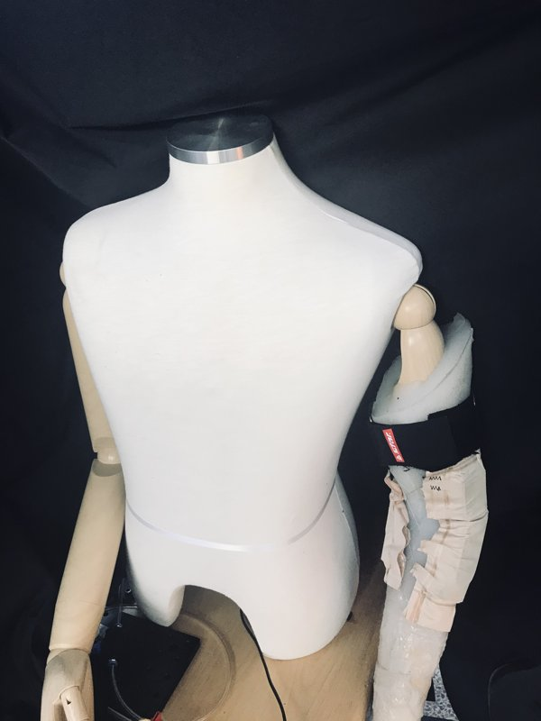 | 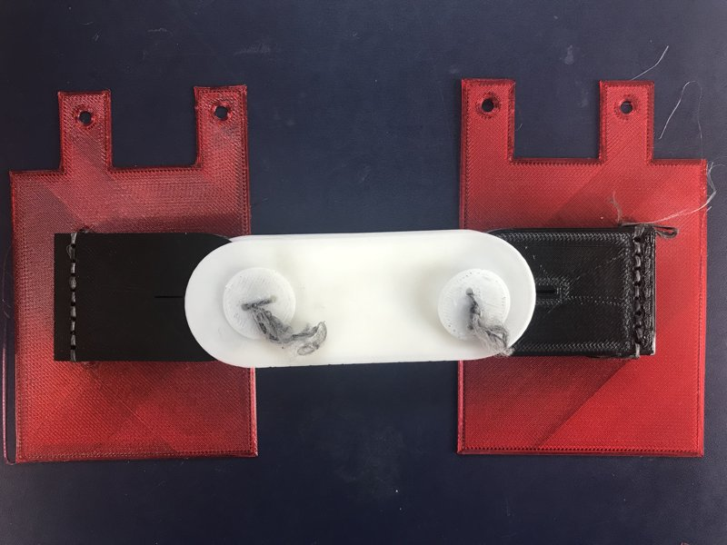 | 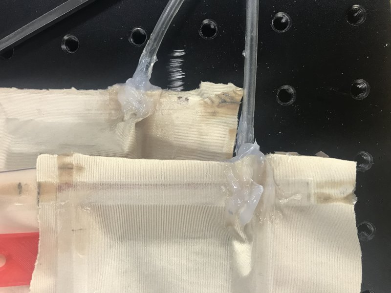 | 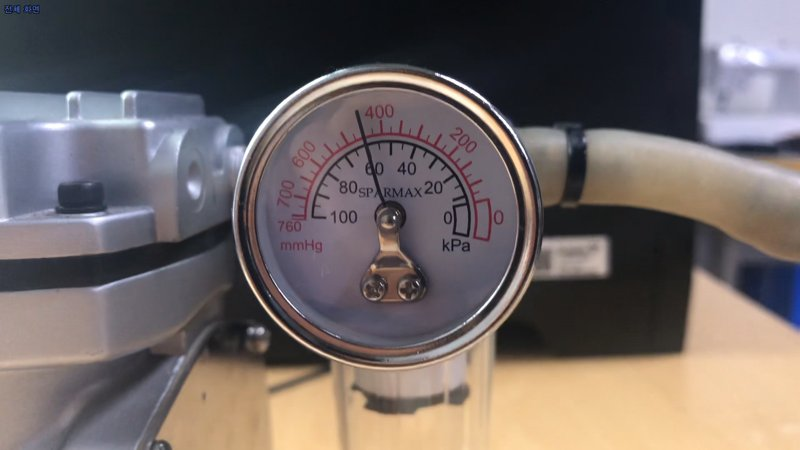 |

- **Anchoring:** TPU anchoring, epoxy anchoring and string anchoring (later a Boa dial) to pass force from the SLLJ to the arm.
- **Sealing:** heat-sealed enclosure, hose joints sealed with Sil-Poxy. The enclosure reached **60 kPa** vacuum by the Winter Mester final (Mar 2021; maximum 80 kPa); after the May 2021 redesign it reached about **70 kPa** (remaining leak at the hose joint).
- **Wearability:** elastic sleeve with hook-and-loop straps, shaped for the biceps change during flexion, so one person can put it on alone and wear it under a jacket.

| SLLJ module: vacuum on, pushed by hand | Putting on the sleeve |
|:--:|:--:|
| 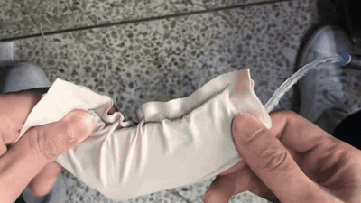 | 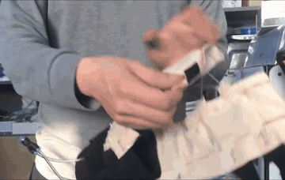 |

| Moving a hand tool, vacuum OFF | Moving a hand tool, vacuum ON |
|:--:|:--:|
| 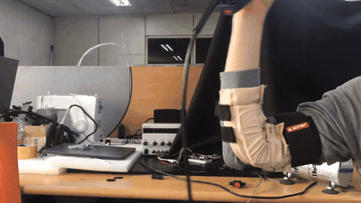 | 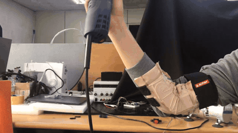 |

---

## 📈 Biosignal Processing

Studied biosignal-based human motion analysis for assistive robotic applications.

### Highlights

- Processed and analyzed EMG biosignals
- Investigated muscle activation patterns
- Explored sensing-driven human–robot interaction
- Supported the development of intention-aware assistive systems

### EMG Test (Mar – Apr 2021)

| Electrode placement (Delsys Trigno) | Isometric hold with 0.5 kg, sleeve on |
|:--:|:--:|
| 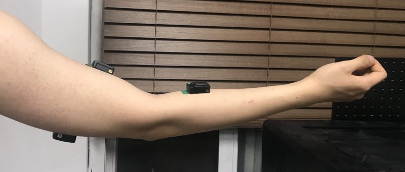 | 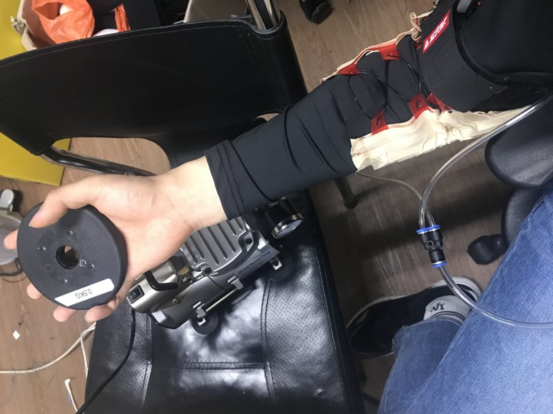 |

- **Muscles:** biceps brachii, triceps brachii, brachioradialis.
- **Protocol:** EMG min (rest) and max (isometric) first, then an isometric hold of a 500 g weight, 3 trials without the sleeve and 3 trials with the SLLJ sleeve (vacuum on).
- **Analysis (MATLAB):** low-pass filter on the raw signal, then the mean of each trial.

| Without sleeve | With SLLJ sleeve (vacuum on) |
|:--:|:--:|
| 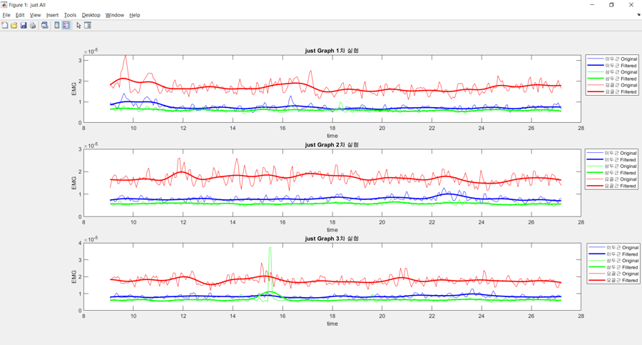 | 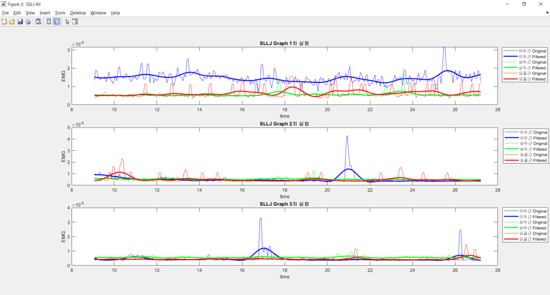 |

Mean EMG per trial (raw MATLAB output, ×10⁻⁵):

| Trial | Biceps (without → with) | Triceps (without → with) | Brachioradialis (without → with) |
|:--:|:--:|:--:|:--:|
| 1 | 0.742 → 1.469 | 0.600 → 0.554 | 1.694 → 0.634 |
| 2 | 0.800 → 0.497 | 0.581 → 0.529 | 1.718 → 0.499 |
| 3 | 0.835 → 0.464 | 0.643 → 0.556 | 1.773 → 0.443 |

**Result:** muscle activity went down with the sleeve in most cases (all three muscles in trials 2 and 3); biceps went up in trial 1.
**Limits (from the lab meetings):** this was a small preliminary test. Air leakage kept the vacuum below target, the max-value protocol was not yet reliable (some data fell below the measured min), and outlier removal was dropped because it could distort the data. Next steps were a stricter EMG max protocol and a better-sealed enclosure.

---

## 🛠 Mechanical Prototyping

Developed functional prototypes through an iterative hardware design process.

### Highlights

- CAD modeling using SolidWorks
- Rapid prototyping with 3D printing
- CNC machining and assembly
- Mechanical testing and design refinement

---

# ⚙️ Technical Skills

## Robotics

- Human–Robot Interaction
- Wearable Robotics
- Assistive Robotics

## Mechanical Design

- SolidWorks
- 3D Printing
- CNC Machining
- Rapid Prototyping

## Signal Processing

- EMG Analysis
- Human Motion Analysis

## Programming

- MATLAB
- Python

---

# 📂 Repository Structure

```text
WearableElbowAssistSleeve/
├── README.md
└── images/
    ├── design/   # sleeve, anchoring, sealing and vacuum photos
    ├── tests/    # GIFs from test videos
    └── emg/      # EMG setup photos and MATLAB graphs
```

The design files, test videos and MATLAB scripts stayed in the lab; this repository is a write-up with figures from the lab presentations.

---

# 🎯 Research Interests

This project explored how robotic systems can better understand and assist human motion by combining wearable mechanisms, biosignal sensing, and human-centered design.

Research interests include:

- Wearable Robotics
- Human–Robot Interaction
- Assistive Technologies
- Biosignal-Based Control
- Human Motion Analysis
- Rehabilitation Robotics

---

# 📈 Future Directions

- Soft Wearable Robotics
- Human Intention Estimation
- Adaptive Assistive Systems
- EMG-Based Control
- Rehabilitation Robotics
- Human-Centered AI
